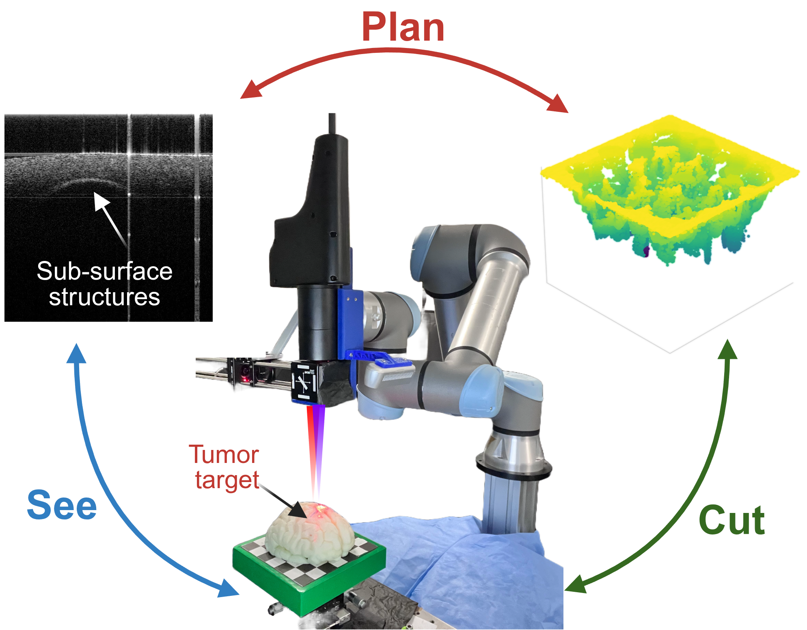
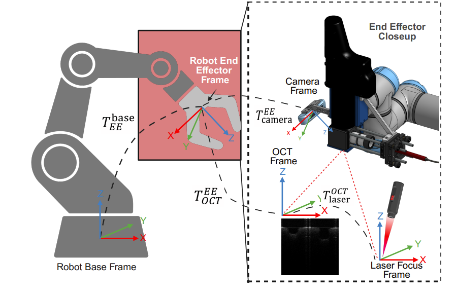
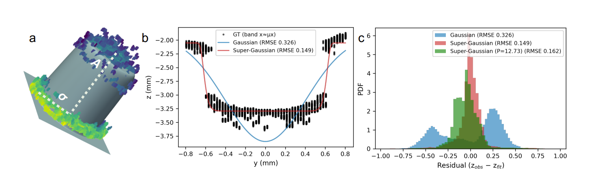

# See Plan Cut Codebase Overview

This document is designed to serve as a comprehensive codebase and conceptual guide for the robotic system developed in the referenced paper.

*Authors: Ravi Prakash\*, Vincent Y. Wang\*, Arpit Mishra, Devi Yuliarti, Pei Zhong, Ryan P. McNabb, Patrick J. Codd, Leila J. Bridgeman*

[](https://arxiv.org/abs/2511.17777)  [](https://raprakashvi.github.io/see-plan-cut/)   [](https://2026.ieee-icra.org/)




*The **See → Plan → Cut** loop: OCT provides sub-surface tissue feedback, an MPC-based planner computes the optimal ablation sequence, and the UR5e robot delivers precise laser pulses — closing the loop autonomously.*

## Table of Contents

- [Equipment & Control](#equipment--control)
  - [System Hardware Overview](#system-hardware-overview)
  - [UR5e Robot and End Effector](#ur5e-robot-and-end-effector)
  - [OCT Scanner](#oct-scanner)
  - [Nd:YAG Laser and Raspberry Pi Control](#ndyag-laser-and-raspberry-pi-control)
- [Setup & Scope](#setup--scope)
- [Calibration and Coordination Frames](#calibration-and-coordination-frames)
  - [Calibration Data Collection](#calibration-data-collection)
- [Ablation Model and Cut Simulator](#ablation-model-and-cut-simulator)
  - [Ablation Crater Model Fitting](#ablation-crater-model-fitting)
  - [Cut Simulator & Ablation Planners](#cut-simulator--ablation-planners)
- [Executing Planned Cuts](#executing-planned-cuts)
  - [Digesting the Code](#digesting-the-code)
  - [Transforming a Planned Target into Robot Motion](#transforming-a-planned-target-into-robot-motion)
  - [Configuration and Practical Limitations](#configuration-and-practical-limitations)
- [utils/UR5Controller.py](#utilsur5controllerpy)
- [Single Shot Ablation](#single-shot-ablation)
- [Results + Analysis](#results--analysis)
  - [Laser-Power Repeatability](#laser-power-repeatability)
  - [Laser-Calibration Error](#laser-calibration-error)
  - [Crater-Fit Analysis](#crater-fit-analysis)
  - [Multi-Shot Crater Analysis](#multi-shot-crater-analysis)
  - [Final Resection Depth-Map Analysis](#final-resection-depth-map-analysis)
- [Future Work](#future-work)

## Equipment & Control

First, we are looking at general equipment and control of the system:

### System Hardware Overview

| Component | Role in System | Control or Data Interface |
|---|---|---|
| UR5e robot | Positions and orients the laser end effector | Real-Time Data Exchange (RTDE) through `UR5Controller.py` |
| Optical Coherence Tomography (OCT) scanner | Produces sub-surface tissue scans for mapping and feedback | OCT acquisition software and calibration workflow |
| Nd:YAG laser | Removes tissue through laser ablation | Pulse-Width Modulation (PWM) duty cycle, frequency, and pulse time |
| Raspberry Pi | Receives and applies laser PWM commands | Socket-based laser-control server |
| Intel RealSense camera | Provides macro-scale scene and positioning information | Hand-eye calibrated RGB-D camera |
| Co-axial optics | Aligns OCT sensing and laser delivery at the treatment site | Collimator, focusing lens, and kinematic mount |

---
### UR5e Robot and End Effector

The Universal Robots UR5e robotic arm (UR5e) positions and orients the laser relative to the planned tissue target. Each planned laser shot contains a target location, approach angle, and laser duty cycle. The laser duty cycle describes the percentage of the pulse period that the laser is turned *on* (i.e., at 100Hz frequency, a 50% duty cycle will have a laser on for 5 ms).

Before executing a cut, the robot model is loaded and visualized using PyBullet, a simulated physics environment to support positioning calculations. A separate physical-robot connection is then established through RTDE, which sends the verified motion commands to the actual UR5e.

**UR5e control sequence:**

1. Load the UR5e model in PyBullet.
2. Connect to the physical robot.
3. Transform the planned target into the robot world frame.
4. Move the laser end effector to the target pose.
5. Trigger the laser pulse.
6. Return the robot to a safe position when required.

### OCT Scanner

OCT is the key way the robot knows what it is ablating at any given moment. OCTs create a high-resolution, low-depth 3D map of the region below the surface being ablated, allowing for predictive actions. It works by comparing the differences between reflected near-IR light interacting with sublayers of a region. The ideal workflow involves the OCT working in tandem with the ablator, creating continuous maps of the crater and remaining tissue, enhancing our ability to protect viable, healthy cells. 

### Nd:YAG Laser and Raspberry Pi Control

This component is how the ablation is executed. The neodymium-doped yttrium aluminum garnet (Nd:YAG) laser emits 1060-nanometer light that delivers concentrated energy to the target tissue, removing it. This process happens downstream of OCT scanning and controller planning, activated using `planned_cut_execute.py`. 

## Setup & Scope

Much of the hardware used is lab-specific. The required python packages can be installed using the following:

```bash
pip install numpy scipy matplotlib pyvista open3d pybullet \
            rtde-python3 opencv-python plotly seaborn \
            line_profiler
```
Understanding the capabilities of each of these packages is not essential for controlling the robot.

## Calibration and Coordination Frames

Calibration is a necessary quality of any robotics system. However, given the potential cost of error in this system and the finite margins that the end effector works on, our calibration must as precise and consistent as possible. The following section reviews how the system and its components are calibrated.

---


*Visualization of key coordinate frames that must be calibrated for accurate communication between the functioning components of the robotics system.*

```math
{}^{\mathrm{base}}\mathbf{T}_{\mathrm{laser}}
=
{}^{\mathrm{base}}\mathbf{T}_{\mathrm{EE}}
\,
{}^{\mathrm{EE}}\mathbf{T}_{\mathrm{OCT}}
\,
{}^{\mathrm{OCT}}\mathbf{T}_{\mathrm{laser}}
```

*The above equation is the key transformation required for calibration*

---
### Calibration Data Collection

The following review background on the first executable command, meant to gain the transformation matrix between the laser and OCT:

```bash
python oct_calib.py
```
The user will first need to place a calibration target in the task space of the robot. This can be any planar calibration target with circular markers.

The robot will first run through a series of pre-set positions set under `poses`. `poses` is simply a $N x 6$ array of radian values for each axis of the UR5e robot. Each position is accessed through the running of command:

`runOCTScan()`

Each run saves the resultant transformation matrix under:

 `./data/calibrationOCT/fkMat.npy`

Specific OCT data is saved under:

`./data/calibrationOCT/scans`

The saved OCT data is then run to `findCircleCoords()`, where point cloud and color intensity data are used to create a singular greyscale image. With that, the relative coordinates of the circular markers on the calibration target can be identified.

Using these marker coordinates, a coordinate frame can be developed, with an origin being set as one of the markers. This marker frame can be located within the given OCT frame, and after comparing the frames from each of the pre-set `poses` list, the ${}^{\mathrm{EE}}\mathbf{T}_{\mathrm{OCT}}$ can be set. This transformation matrix will be labeled as `EE2OCT` and saved to `utils/UR5Controller.py`

To confirm, the markers are reprojected and measurements redone. The calibration error can be noted and saved separately.

## Ablation Model and Cut Simulator

What makes this robotics system precise is its ability to forward-think using a Model-Predicive Controller (MPC). This enables the system to review multiple different pathways of cuts and select the option that generates the least amount of cost, or damage to healthy tissue. The second executable command relies on this MPC to determine what type of cut to make:

```bash
cd planner && python ablation_planner.py
```

While understanding how the MPC functions is not essential to how to control the robotic system, it can be helpful for understanding certain design choices.

### Ablation Crater Model Fitting

`ablation_crater_fitting.py` takes an experimentally analyzed ablation crater and fits that to a mathematical model that can be used to predict the effect of future laser shots. The current version relies on previously loaded OCT data and does not update the modeling live.

Using the point cloud data from the imported OCT scans, a user can select a center point and a cutoff height. Then, applying a standard Gaussian curve to the crater, the system can estimate the depth and width of the crater. With the estimated width, excess points that do not lie on the crater edge can be removed (>2 crater widths) to ease calculations and remove unnecessary influence. The model then also compares a super-Gaussian curve, which can represent a flatter crater, and a thresholded super-Gaussian curve to represent low-energy regions that may not have been ablated. These models are then compared against each other for accuracy using root mean square error (RMSE). The output will be the fitted crater parameters and the error values. 

---



*The above is a figure pulled from the relevant paper, note specifically (b) which compares a Gaussian model and super-Gaussian model to an example point cloud. The super-Gaussian fits more closely to the point cloud and that is confirmed by the RMSE in (c).*

---

Super-Gaussian generally provides the better fit. The following equation is used to typically define the ablation model:

```math
z(x,y) = -A \exp\!\left(-\left(\frac{(x-\mu_x)^2+(y-\mu_y)^2}{2\sigma^2}\right)^P\right) + d$$
```

A truncated variant enforces a minimum ablation threshold $\phi$, preventing shallow over-deposition at crater edges. Parameters $(A, \sigma, P)$ are fit from experimental OCT crater scans. Here, $A$ is ablation amplitude, setting the maximum depth, $\sigma$ is the beam spread, controlling the lateral width of the crater, and $P$ is the steepness of the Gaussian walls. For $P$, a value of $P=1$ is perfectly Gaussian and as $P>1$, the crater becomes flatter.

### Cut Simulator & Ablation Planners

Now that we have a model for how a given ablation changes a surface, we can begin to predict successive cuts. `cut_simulator.py` is this system's key forward model, relying on the output from above to predict what a certain laser pulse will do without having to physically fire one. From a current OCT input and the parameters of a candidate shot (laser position, incidence angle, and duty cycle), it can estimate the potential laser-tissue interaction. Were the cost of a shot considered too high, the proposed configuration can be scrapped. The key pathway to understand is:

**Current tissue surface + Candidate shot → Predicted next tissue surface**

The information from `cut_simulator.py` is then sent to `ablation_planner.py`, which is the engine of the MPC. The ablation planner is given 3 key surfaces:

| Surface            | Definition                                                                                                                                    | Role in Planning                                           |
| ------------------ | --------------------------------------------------------------------------------------------------------------------------------------------- | ---------------------------------------------------------- |
| Current surface    | The system’s present estimate of the tissue geometry, obtained from an Optical Coherence Tomography (OCT) scan or previous simulation result. | Starting state for planning.                               |
| Objective surface  | The target geometry defining the tissue volume that should be removed.                                                                        | Used to measure remaining tissue and score candidate cuts. |
| Constraint surface | A protected boundary or critical structure that the laser must not cross.                                                                     | Rejects unsafe candidate cuts.                             |

The key workflow of `ablation_planner.py` is it generates random candidate shots, and sends those parameters to `cut_simulator.py` to have the predicted surface returned. From there, a cost analysis is executed where plans that ablate too high a cost of the constraint surface are removed and ones that pass are added to a nodal tree. This process is repeated until a horizon, $k_F$, is reached. 

All branches are analyzed assessing the cost of the series of cuts. The algorithm doing this naturally favors undercutting as opposed to overcutting into the constraint surface as the key evaluation point. The sequence of nodes is returned as a $N x 5$ matrix, `inputSeq[]`, where N defines the number of nodes in the desired sequence.

`inputSeq = [x position, y position, x angle, y angle, duty cycle]`

**Clarification:** The horizon, $k_F$, should be viewed as a total number of nodes that the tree will check for in a given planning cycle, not a certain chain length that should be met. This means that `inputSeq[]` could be a wide length of cuts and that the time between running `ablation_planner.py` could vary. 

## Executing Planned Cuts

With the MPC having determined the most 'ideal' cut parameters that are now stored in `inputSeq[]`, we are ready to make a cut. The following section dives deeper into the third executable code:

```bash
python planned_cut_execute.py
```
### Digesting the Code

Some notable unique commands:

`plane()`: evaluates hard-coded plane coefficients at a supplied $(x,y)$ location.

`laserCut()`: executes cut based off provided laser parameters

`scanOCT()`: Scans the OCT, only defined here

---

Using `plane()` and hard-coded coefficients, a transformation matrix to translate between the OCT and the tissue-frame is made, `Hmat[]`.

It then double checks to make sure that ablation values are valid. It primarily checks that duty cycle is between 0.1 & 1

Using the other values from the input we can define two important variables:

| Variable        | Definition                                                                                                                                     |
| --------------- | ---------------------------------------------------------------------------------------------------------------------------------------------- |
| `pointTissueF`  | Defines the exact target spot on the local tissue surface. Its x- and y-coordinates select the planned cutting location on the tissue plane.   |
| `normalTissueF` | Defines the desired direction of the laser axis at that target spot. It determines the angle at which the laser is oriented toward the tissue. |


These two metrics are defined in the tissue's coordinate frame. For the robot to understand the position it needs to be in the values are converted to a world postion, represented by `normalWorld` and `pointWorld`

With information the robot can understand, we can call `utils.robotMove()` to move the robot arm to the appropriate location and execute `laserCut`.

### Transforming a Planned Target into Robot Motion

The planned-cut script combines several transformations to locate each laser target in the robot world frame:

```math
\mathbf{p}_{world}
=
{}^{world}\mathbf{T}_{EE}
\,
{}^{EE}\mathbf{T}_{OCT}
\,
{}^{OCT}\mathbf{T}_{tissue}
\,
\mathbf{p}_{tissue}
```

Here, `fkMat` represents the robot end-effector pose when the OCT scan was collected, `EE2OCT` is the calibrated end-effector-to-OCT transformation, and `Hmat` maps the local tissue frame into the OCT frame. The resulting `pointsWorld` value specifies where the laser should be positioned.

The same transformation process is applied to the planned surface normal. The output, `normalWorld`, specifies the direction in which the laser should point. The helper function `utils.robotMove()` uses `pointsWorld`, `normalWorld`, and `robot.LASER_LINK_INDEX` to move the laser link to the desired pose before executing the laser-control function.

Each planned shot has the form:

`[x position, y position, x angle, y angle, duty cycle]`

This is filled from `inputSeq` in the planner.

### Configuration and Practical Limitations

Several values used by the controller are specific to the experimental setup: the robot IP address, URDF model, home joint configuration, calibrated `EE2OCT` matrix, and laser-link index. These values should be measured or verified for a new setup rather than copied without validation.

The paper reports an OCT-to-laser calibration error of $0.161 \pm 0.031$ mm. This establishes the approximate lower bound on targeting accuracy, but it does not equal final resection error. Crater-model error, focal variation, debris, tissue properties, and repeated robot repositioning can all add further error.

The current lack of a `z position` during ablation will potentially increase difficulty of overhang cuts. Could be remedied using more extreme cutting angles.

Another note, given that the ablation has the tendency to spray particles, every 5 cuts the process will pause for the user to clear a lens cover. It is vital that this cover be cleaned as interference with the lens view can cause severe innaccuracies over time.

## utils/UR5Controller.py

`UR5Controller.py` defines the connection between the physical robot and the supporting planning and calibration software. This controller recieves inputs from the simulation model and the UR Real-Time Data Exchange (RTDE) interface to execute positioning and ablation

The controller is used by both `laser_ablation.py` and `planned_cut_execute.py`. The script defines `connect_physical_robot()` before motion and `disconnect_physical_robot()` when physical control is no longer needed.

Some key functions to note within `UR5Controller.py`:

`check_position_feasibility` - returns the orientation and position error of the robot based off the submitted joint angles

`get_arm_ik_pybullet` - returns an inverse kinematics array from a current position. `2d_pose` defines the desired position, drawn from `pointsWorld` in `planned_cut_execute.py`

`2d_pose = [target position, target orientation]`

The rest of the controller contains standard controller functions to utilize. Review repository if unfamiliar.

## Single Shot Ablation

This section will briefly review `laser_ablation.py`, which is the system's single shot workflow. 

Unlike the previously reviewed `planned_cut_execute.py`, it does use a sequence calculated by the MPC. Instead, it moves the laser to one manually specified target, fires one controlled pulse, and returns the robot home. This would be the preferred methodology for simple characterizations and experiments.

The script begins with a target point in the OCT frame, represented by `points`, and a local surface-normal vector, represented by `normal`. This point should be submitted as millimeters. Using forward kinematics, `fkMat` and the end effector to OCT frame, `EE2OCT`, the process produces `pointsWorld` and `normalWorld`. Currently the calculation for `points` and `normal` are not automated and must be done manually and updated within `laser_ablation.py`.

Finally, `utils.robotMove()` moves the laser link to the requested position and orientation, calls `laserCut()`, and returns the robot to its home pose.

## Results + Analysis

The `analysis/` directory evaluates the system from laser input through final resection outcome.

| Script | Primary purpose | Main output |
|---|---|---|
| `laser_power_repetability.py` | Verify repeatable energy delivery | Energy mean and variation at each duty cycle |
| `laser_calibration_error.py` | Quantify targeting accuracy | Laser-spot position error |
| `crater_fit_analysis.py` | Compare crater-model accuracy | Fit parameters and RMSE |
| `volume_resection_crater_analysis.py` | Examine individual cuts during a resection | Crater geometry and variability across cuts |
| `volume_resection_depthmap.py` | Evaluate final resection geometry | Depth maps, RMSE, MAE, and IoU |

### Laser-Power Repeatability

`laser_power_repetability.py` examines repeated power-meter measurements at the same commanded duty cycle. Rather than assuming that a 50% duty cycle always produces the same energy, it measures the actual delivered energy and its variation. This is the first check in the analysis workflow because an inconsistent laser command would create inconsistent crater geometry, even if robot positioning and the crater model were perfect.

### Laser-Calibration Error

`laser_calibration_error.py` measures the difference between an intended target and the measured laser-spot location. It evaluates the practical accuracy of the OCT-to-laser calibration chain, including the transformation between the OCT, end-effector, and laser frames. The paper reports a calibration error of $0.161 \pm 0.031$ mm. This result measures targeting accuracy, not the final accuracy of tissue removal.

### Crater-Fit Analysis

`crater_fit_analysis.py` compares how well different crater-shape models represent measured OCT crater data. The script uses RMSE to quantify the difference between a model-predicted crater surface and the measured surface. It also helps determine whether fitted parameters, such as crater depth and width, remain consistent across experiments.

The paper reports an average super-Gaussian fitting RMSE of $0.231 \pm 0.121$ mm. Lower RMSE means the model more accurately predicts how a laser shot changes the tissue surface.

### Multi-Shot Crater Analysis

`volume_resection_crater_analysis.py` examines individual crater behavior during a larger resection rather than in isolation. This matters because the tissue surface changes after each shot. Focus distance, debris, overlap with neighboring shots, and changes in surface angle can cause a crater within a sequence to differ from the crater predicted under isolated conditions.

This script is therefore useful for identifying whether error begins at the single-crater level or accumulates primarily over a longer sequence of cuts.

### Final Resection Depth-Map Analysis

`volume_resection_depthmap.py` compares the intended resection geometry with the OCT-measured geometry after cutting. It produces depth-error maps, allowing the user to see *where* the system undercut or overcut, rather than relying only on a single summary value.

Its primary numerical metrics are RMSE, MAE, and IoU. RMSE and MAE describe depth mismatch, while IoU measures the overlap between the desired and achieved resection volumes.

| Method | RMSE | MAE | IoU |
|---|---:|---:|---:|
| No feedback | 1.007 mm | 0.797 mm | 21.1% |
| OCT feedback | 0.842 mm | 0.630 mm | 60.0% |

The reported improvement with OCT feedback shows why repeated scanning and replanning are important: the system can correct for errors that arise during execution instead of following its original cut sequence unchanged.

## Future Work

Here is a listing of some potential projects of interest based off this review:

1. A fully closed loop system consisting of scan &rarr; plan &rarr; cut

2. 3D, curved surfaces consideration for planned cut inputs. Current inputs only ask for a `x position` and `y position` along with a series of angles 

3. Continuous model updating parameters during full cutting processes

4. Added quality metric for lens cleaning as opposed to pre-set 5 count. Could also implement automated system via hardware integration
